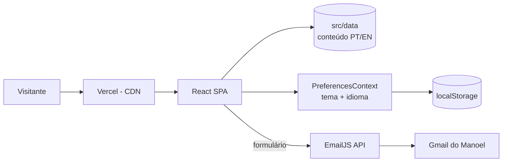
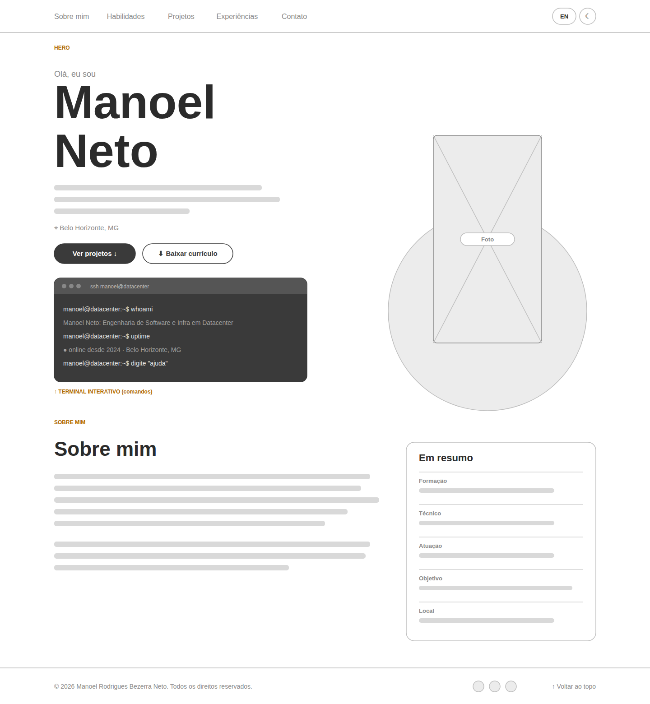
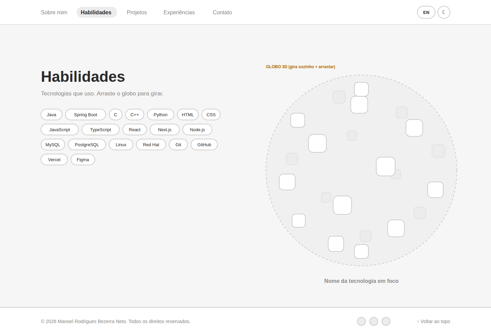
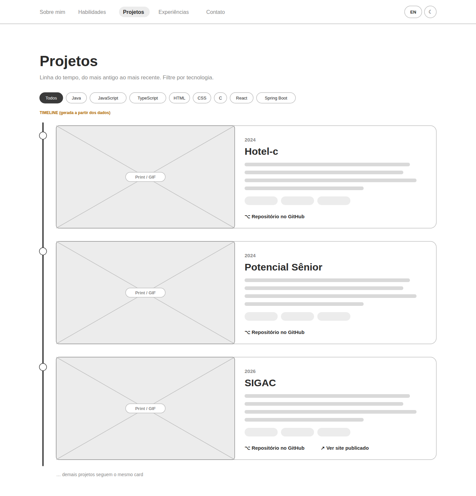
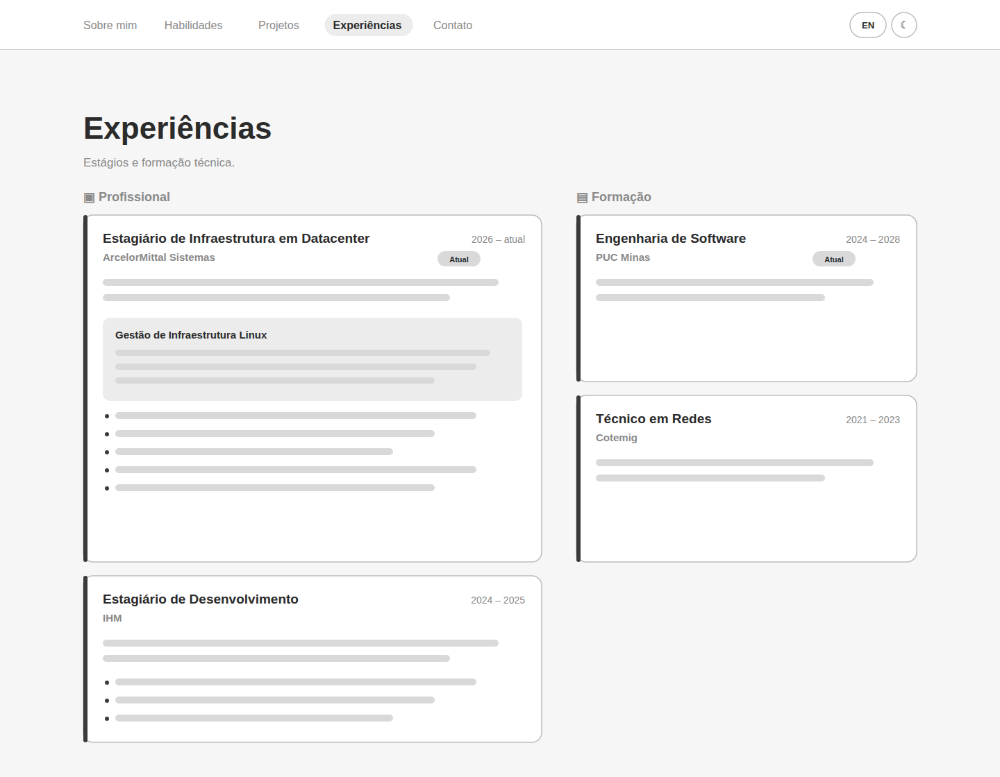
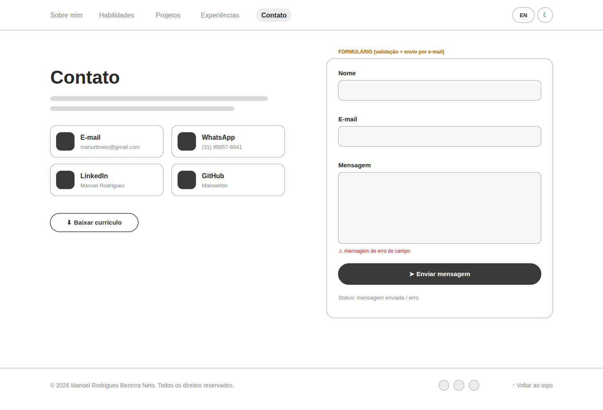
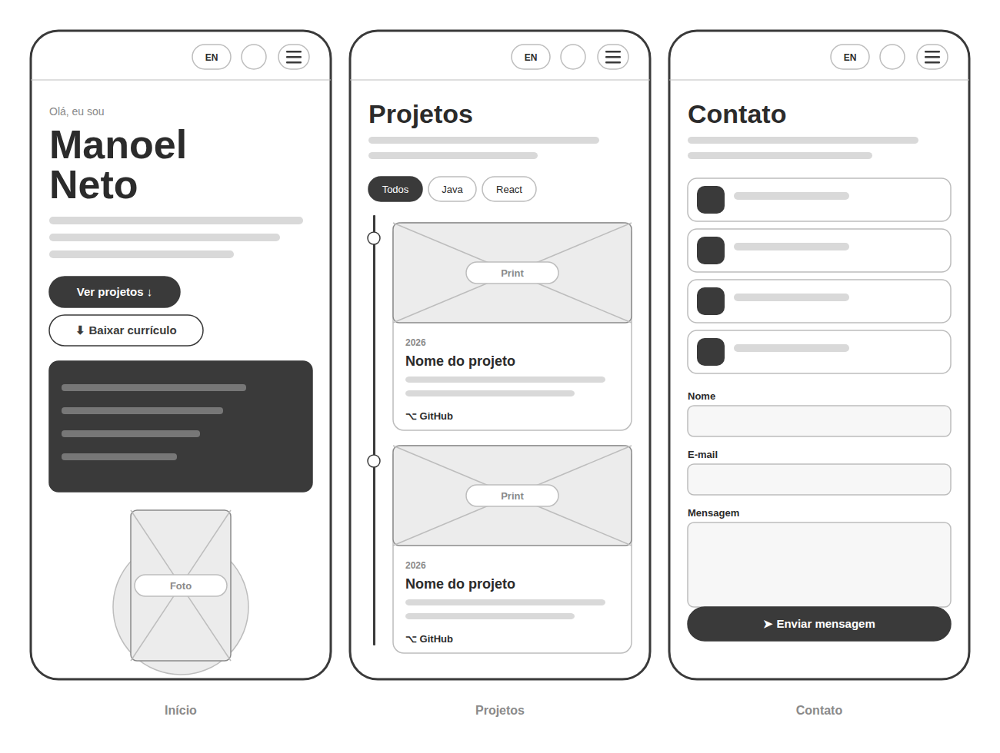

---

# 🌿 Portfólio Profissional — Manoel Neto 👨‍💻

> [!NOTE]
> Website de portfólio profissional que apresenta minha trajetória, habilidades, projetos e formas de contato, com **versão em português e inglês**, **tema claro/escuro** e **globo 3D interativo de habilidades**.

<table>
  <tr>
    <td width="800px">
      <div align="justify">
        Este repositório contém o <b>portfólio profissional</b> de <b>Manoel Rodrigues Bezerra Neto</b>, estudante de Engenharia de Software na <b>PUC Minas</b> e estagiário de Infraestrutura de Projetos na <b>ArcelorMittal Sistemas</b>. O site foi desenvolvido no <b>Laboratório 01</b> da disciplina <i>Desenvolvimento e Integração de Aplicações Web (DIAW)</i>, com <b>React</b> e <b>Vite</b>, e reúne as seções <i>Sobre mim</i>, <i>Habilidades</i>, <i>Projetos</i> (linha do tempo), <i>Experiências</i> e <i>Contato</i> (com formulário de envio por e-mail via <b>EmailJS</b>). A identidade visual usa tons de <b>verde</b>, é <b>responsiva</b> e respeita as preferências de acessibilidade do usuário.
      </div>
    </td>
    <td>
      <div>
        
      </div>
    </td>
  </tr>
</table>

---

## 🚧 Status do Projeto


---

## 📚 Índice
- [Links Úteis](#-links-úteis)
- [Sobre o Projeto](#-sobre-o-projeto)
- [Funcionalidades Principais](#-funcionalidades-principais)
- [Tecnologias Utilizadas](#-tecnologias-utilizadas)
- [Arquitetura](#-arquitetura)
- [Como Usar o Site](#-como-usar-o-site)
- [Protótipos (Figma)](#-protótipos-figma)
- [Instalação e Execução](#-instalação-e-execução)
  - [Pré-requisitos](#pré-requisitos)
  - [Variáveis de Ambiente](#-variáveis-de-ambiente)
  - [Instalação de Dependências](#-instalação-de-dependências)
  - [Como Executar a Aplicação](#-como-executar-a-aplicação)
- [Deploy](#-deploy)
- [Estrutura de Pastas](#-estrutura-de-pastas)
- [Demonstração](#-demonstração)
- [Testes](#-testes)
- [Documentações utilizadas](#-documentações-utilizadas)
- [Autores](#-autores)
- [Contribuição](#-contribuição)
- [Agradecimentos](#-agradecimentos)
- [Licença](#-licença)

---

## 🔗 Links Úteis
* 🌐 **Site publicado:** [Acesse o portfólio](https://manoel-neto.vercel.app) <!-- TODO: substituir pelo link da Vercel após o deploy -->
  > 💻 **Descrição:** Versão de produção hospedada gratuitamente na Vercel.
* 🎨 **Protótipo no Figma:** [Wireframes de média fidelidade](https://www.figma.com/design/u5Yj2kR8aTBwNi8baaMu9m/Untitled?node-id=0-1&t=U2mAgt4wpjNEEVm5-1) 
* :octocat: **Repositório:** [github.com/Manoelrbn/Portifolio-Profissional](https://github.com/Manoelrbn/Portifolio-Profissional)

---

## 📝 Sobre o Projeto

**Por que existe:** apresentar minha trajetória profissional de forma moderna e acessível para recrutadores, professores e colegas, reunindo em um só lugar formação, estágios, projetos e contatos.

**Que problema resolve:** o currículo em PDF não mostra os projetos funcionando. O portfólio liga cada projeto ao seu repositório no GitHub, mostra imagens/GIFs das telas e permite que qualquer pessoa entre em contato direto pelo formulário.

**Contexto:** acadêmico — Laboratório 01 (15 pontos) da disciplina DIAW, Engenharia de Software, PUC Minas, ministrada pelo Prof. Dr. João Paulo Carneiro Aramuni.

**Onde pode ser usado:** link no LinkedIn, no currículo e em processos seletivos de estágio.

---

## ✨ Funcionalidades Principais

- 💻 **Terminal interativo (diferencial):** no topo do site há um terminal no estilo SSH de datacenter. O visitante digita comandos como `ajuda`, `sobre`, `skills`, `projetos`, `contato`, `cv`, `tema` e `idioma` para navegar, baixar o currículo ou trocar o tema. Tem histórico de comandos com as setas ↑/↓.
- 🧭 **Menu de navegação:** cabeçalho fixo com links para todas as seções, destaque da seção visível e menu hambúrguer no celular.
- 🙋 **Sobre mim (PT/EN):** apresentação com formação, área de atuação, interesses e objetivos profissionais, com troca de idioma em um clique (a escolha fica salva).
- 🌐 **Internacionalização (i18n):** todo o site (não só o "Sobre mim") alterna entre português e inglês.
- 🌗 **Tema claro e escuro:** botão no cabeçalho; respeita a preferência do sistema na primeira visita e salva a escolha no `localStorage`.
- 🌍 **Globo 3D de habilidades:** ícones distribuídos em uma esfera (espiral de Fibonacci) que gira sozinha e pode ser arrastada com mouse ou dedo, com inércia. Inclui lista acessível das mesmas habilidades.
- 🗂️ **Projetos em linha do tempo dinâmica:** gerada a partir de `src/data/projects.js`, ordenada do mais antigo ao mais recente, com filtros por tecnologia criados automaticamente. Cada projeto tem nome, descrição, tecnologias, link para o GitHub e imagem/GIF.
- 💼 **Experiências:** estágios (ArcelorMittal Sistemas, com destaque para Gestão de Infraestrutura Linux, e IHM) e formação (PUC Minas e Cotemig) com empresa/instituição, cargo, período e descrição.
- 📨 **Contato:** ícones clicáveis para e-mail, WhatsApp, LinkedIn e GitHub + formulário (nome, e-mail, mensagem) com **validação** e **envio por e-mail via EmailJS**. Sem credenciais configuradas, o formulário abre o app de e-mail já preenchido.
- 📄 **Download do currículo** em PDF.
- 📱 **Responsivo e acessível:** layout para celular, tablet e desktop, foco visível no teclado, link "pular para o conteúdo", textos alternativos e suporte a `prefers-reduced-motion`.

---

## 🛠 Tecnologias Utilizadas

### 💻 Front-end

* **Biblioteca:** React 18.3.1
* **Build tool:** Vite 5.4
* **Linguagens:** JavaScript (ES2022+), JSX, HTML5, CSS3 (variáveis CSS, Grid, Flexbox, `color-mix`)
* **Ícones:** React Icons 5.x (Simple Icons, Font Awesome, Feather)
* **Envio de e-mail:** EmailJS (`@emailjs/browser` 4.4.1)
* **Tipografia:** Bricolage Grotesque e DM Sans (Google Fonts)

### 🖥️ Back-end

O projeto não precisa de servidor próprio: o envio de e-mail é feito pelo serviço **EmailJS** direto do front-end, o que mantém a hospedagem 100% gratuita como site estático.

### ⚙️ Infraestrutura & DevOps

* **Hospedagem:** Vercel (plano gratuito)
* **Versionamento:** Git + GitHub
* **Design/protótipos:** Figma

### 📦 Dependências

| Pacote | Versão | Tipo | Para que serve |
|---|---|---|---|
| `react` | ^18.3.1 | dependência | Construção da interface em componentes |
| `react-dom` | ^18.3.1 | dependência | Renderização do React no navegador |
| `react-icons` | ^5.4.0 | dependência | Ícones das tecnologias, redes sociais e interface |
| `@emailjs/browser` | ^4.4.1 | dependência | Envio do formulário de contato por e-mail |
| `vite` | ^5.4.11 | dev | Servidor de desenvolvimento e build de produção |
| `@vitejs/plugin-react` | ^4.3.4 | dev | Suporte a JSX e Fast Refresh no Vite |

---

## 🏗 Arquitetura

Aplicação **SPA (Single Page Application)** estática, organizada em camadas simples:

* **Dados (`src/data`)** — todo o conteúdo (textos PT/EN, projetos, experiências, habilidades) fica separado dos componentes. Para adicionar um projeto, basta incluir um objeto em `projects.js`.
* **Estado global (`src/context`)** — `PreferencesContext` guarda **tema** e **idioma** e persiste as escolhas no `localStorage`.
* **Seções (`src/sections`)** — uma por item do menu.
* **Componentes (`src/components`)** — cabeçalho, rodapé e o globo 3D.



---

## 📖 Como Usar o Site

1. Acesse o [site publicado](https://manoel-neto.vercel.app). <!-- TODO: link da Vercel -->
2. Use o **menu do topo** para ir até *Sobre mim*, *Habilidades*, *Projetos*, *Experiências* ou *Contato*. No celular, toque no ícone ☰.
3. Clique em **EN/PT** para trocar o idioma e no ícone 🌙/☀️ para alternar entre tema escuro e claro. As escolhas ficam salvas.
4. No **terminal do topo**, clique e digite um comando, como `ajuda`, `projetos`, `contato`, `cv`, `tema` ou `idioma`, e aperte **Enter**. As setas ↑/↓ mostram os comandos anteriores.
5. Em **Habilidades**, arraste o globo com o mouse ou o dedo para girá-lo.
6. Em **Projetos**, filtre a linha do tempo por tecnologia e abra o repositório de cada projeto no GitHub.
7. Em **Contato**, use os ícones (e-mail, WhatsApp, LinkedIn, GitHub) ou preencha o formulário e clique em **Enviar mensagem**.

---

## 🎨 Protótipos (Figma)

Wireframes de média fidelidade das telas (desktop e mobile):

| Início e Sobre mim | Habilidades |
|---|---|
|  |  |

| Projetos | Experiências |
|---|---|
|  |  |

| Contato | Mobile |
|---|---|
|  |  |

🔗 Link do Figma: <https://www.figma.com/design/u5Yj2kR8aTBwNi8baaMu9m/Untitled?node-id=0-1&t=U2mAgt4wpjNEEVm5-1> <!-- TODO -->

---

## 🔧 Instalação e Execução

### Pré-requisitos

* [Node.js](https://nodejs.org/) **18 ou superior** (recomendado 20 LTS)
* npm 9+ (já vem com o Node)
* Git

### 🔑 Variáveis de Ambiente

Copie o arquivo de exemplo e preencha com os dados da sua conta no [EmailJS](https://www.emailjs.com/):

```bash
cp .env.example .env
```

| Variável | Onde encontrar no EmailJS |
|---|---|
| `VITE_EMAILJS_SERVICE_ID` | *Email Services* → ID do serviço (ex.: Gmail) |
| `VITE_EMAILJS_TEMPLATE_ID` | *Email Templates* → ID do template |
| `VITE_EMAILJS_PUBLIC_KEY` | *Account* → *General* → Public Key |

O template do EmailJS deve usar as variáveis `{{from_name}}`, `{{from_email}}`, `{{reply_to}}` e `{{message}}`.

> [!IMPORTANT]
> Na Vercel, cadastre as mesmas três variáveis em **Settings → Environment Variables** e faça um novo deploy.

### 📦 Instalação de Dependências

```bash
git clone https://github.com/Manoelrbn/Portifolio-Profissional.git
cd Portifolio-Profissional
npm install
```

### ⚡ Como Executar a Aplicação

```bash
# Ambiente de desenvolvimento (http://localhost:5173)
npm run dev

# Build de produção (gera a pasta dist/)
npm run build

# Visualizar o build localmente (http://localhost:4173)
npm run preview
```

---

## 🚀 Deploy

O deploy é feito na **Vercel**, gratuitamente:

1. Acesse [vercel.com](https://vercel.com/) e entre com o GitHub.
2. Clique em **Add New → Project** e importe o repositório `Portifolio-Profissional`.
3. A Vercel detecta o Vite automaticamente (*Build Command:* `npm run build`, *Output Directory:* `dist`).
4. Em **Environment Variables**, adicione as três variáveis do EmailJS.
5. Clique em **Deploy**. Cada `git push` na branch `main` gera um novo deploy, e cada Pull Request ganha um **Preview** automático.

### 🌐 Domínio próprio (opcional)

Com o **GitHub Student Developer Pack**, é possível registrar grátis por 1 ano um domínio `.me` (Namecheap) ou `.dev` (Name.com). Na Vercel, em **Settings → Domains**, adicione o domínio e crie no painel do registrador os registros DNS (A e CNAME) que a Vercel indicar. O certificado HTTPS é gerado automaticamente.

---

## 📂 Estrutura de Pastas

```
.
├── docs/                         # Imagens usadas no README
│   ├── screenshots/              # Capturas de tela do site
│   └── wireframes/               # Exportações dos wireframes do Figma
├── public/                       # Arquivos servidos sem processamento
│   ├── projects/                 # Imagens/GIFs dos projetos da timeline
│   ├── curriculo-manoel-neto.pdf # Currículo para download
│   └── favicon.svg
├── src/
│   ├── assets/
│   │   └── manoel.webp           # Foto do hero
│   ├── components/
│   │   ├── Header.jsx            # Menu, troca de idioma e de tema
│   │   ├── Footer.jsx
│   │   ├── HeroTerminal.jsx      # Terminal interativo do topo
│   │   └── SkillsGlobe.jsx       # Globo 3D interativo
│   ├── context/
│   │   └── PreferencesContext.jsx# Estado global de tema e idioma
│   ├── data/
│   │   ├── content.js            # Textos PT/EN e dados de contato
│   │   ├── projects.js           # Projetos da timeline
│   │   ├── experiences.js        # Estágios e formação
│   │   └── skills.js             # Habilidades do globo
│   ├── hooks/
│   │   └── useActiveSection.js   # Destaca no menu a seção visível
│   ├── sections/
│   │   ├── Hero.jsx
│   │   ├── About.jsx
│   │   ├── Skills.jsx
│   │   ├── Projects.jsx
│   │   ├── Experiences.jsx
│   │   └── Contact.jsx
│   ├── styles/
│   │   └── global.css            # Tokens de cor (claro/escuro) e estilos
│   ├── App.jsx
│   └── main.jsx
├── .env.example
├── index.html
├── package.json
├── vite.config.js
├── LICENSE
└── README.md
```

---


## 🧪 Testes

Testes manuais realizados a cada sprint:

- [x] Terminal: comandos `ajuda`, `projetos`, `contato`, `tema`, `idioma`, `cv` e `limpar` respondem e navegam corretamente.
- [x] Navegação: todos os links do menu levam à seção correta (desktop e mobile).
- [x] Idioma: o botão PT/EN traduz todas as seções e a escolha persiste ao recarregar.
- [x] Tema: o botão alterna claro/escuro e a escolha persiste ao recarregar.
- [x] Projetos: filtros por tecnologia e links para o GitHub funcionando.
- [x] Formulário: mensagens de erro para nome vazio, e-mail inválido e mensagem curta; envio com sucesso via EmailJS.
- [x] Responsividade: testado em 390px, 768px e 1366px.
- [x] Acessibilidade: navegação por teclado com foco visível.

---

## 🔗 Documentações utilizadas

* 📖 [React](https://react.dev/reference/react)
* 📖 [Vite](https://vitejs.dev/config/)
* 📖 [EmailJS — SDK do navegador](https://www.emailjs.com/docs/sdk/installation/)
* 📖 [React Icons](https://react-icons.github.io/react-icons/)
* 📖 [Vercel — Deploy com Vite](https://vercel.com/docs/frameworks/vite)
* 📖 [MDN — IntersectionObserver](https://developer.mozilla.org/pt-BR/docs/Web/API/Intersection_Observer_API)
* 📖 [Conventional Commits](https://www.conventionalcommits.org/en/v1.0.0/)

---

## 👥 Autores

| 👤 Nome | 🖼️ Foto | :octocat: GitHub | 💼 LinkedIn | 📤 Gmail |
|---------|----------|-----------------|-------------|-----------|
| Manoel Rodrigues Bezerra Neto | <div align="center"></div> | <div align="center"><a href="https://github.com/Manoelrbn"></a></div> | <div align="center"><a href="https://www.linkedin.com/in/manoel-rodrigues-a9a2b9231/"></a></div> | <div align="center"><a href="mailto:manurbneto@gmail.com"></a></div> |

---

## 🤝 Contribuição

1. Faça um `fork` do projeto.
2. Crie uma branch (`git checkout -b feature/minha-feature`).
3. Faça commit das mudanças (`git commit -m 'feat: adiciona nova funcionalidade'`), seguindo [Conventional Commits](https://www.conventionalcommits.org/en/v1.0.0/).
4. Faça `push` da branch (`git push origin feature/minha-feature`).
5. Abra um **Pull Request**.

---

## 🙏 Agradecimentos

* [**Engenharia de Software PUC Minas**](https://www.instagram.com/engsoftwarepucminas/) — pelo apoio institucional e pela estrutura acadêmica.
* [**Prof. Dr. João Paulo Aramuni**](https://github.com/joaopauloaramuni) — pelo laboratório, pelo template deste README e pelos ensinamentos em desenvolvimento web.
* [**Abdul Momin**](https://www.abdulmomin.dev/) — inspiração para o globo interativo de habilidades.

---

## 📄 Licença

Este projeto é distribuído sob a **[Licença MIT](./LICENSE)**.

---
